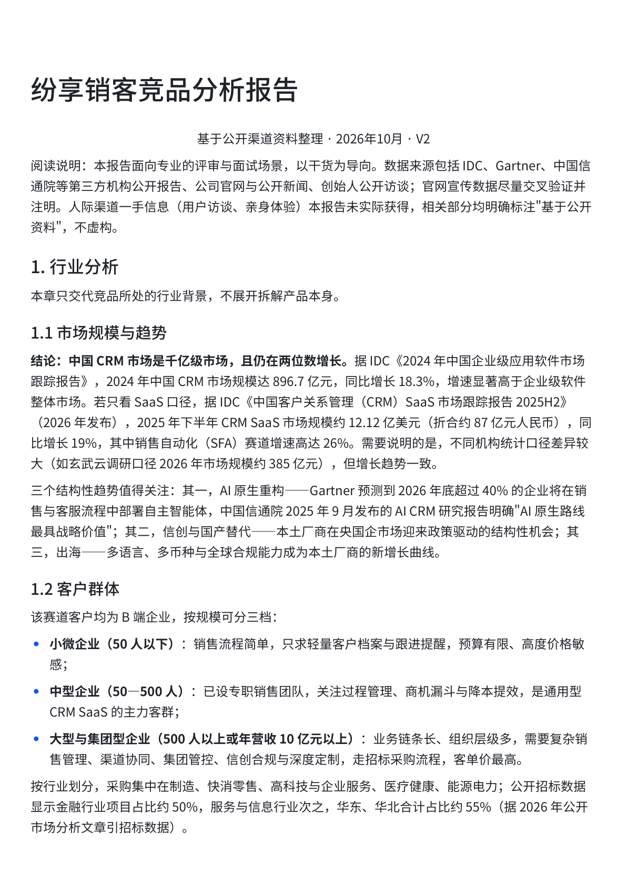
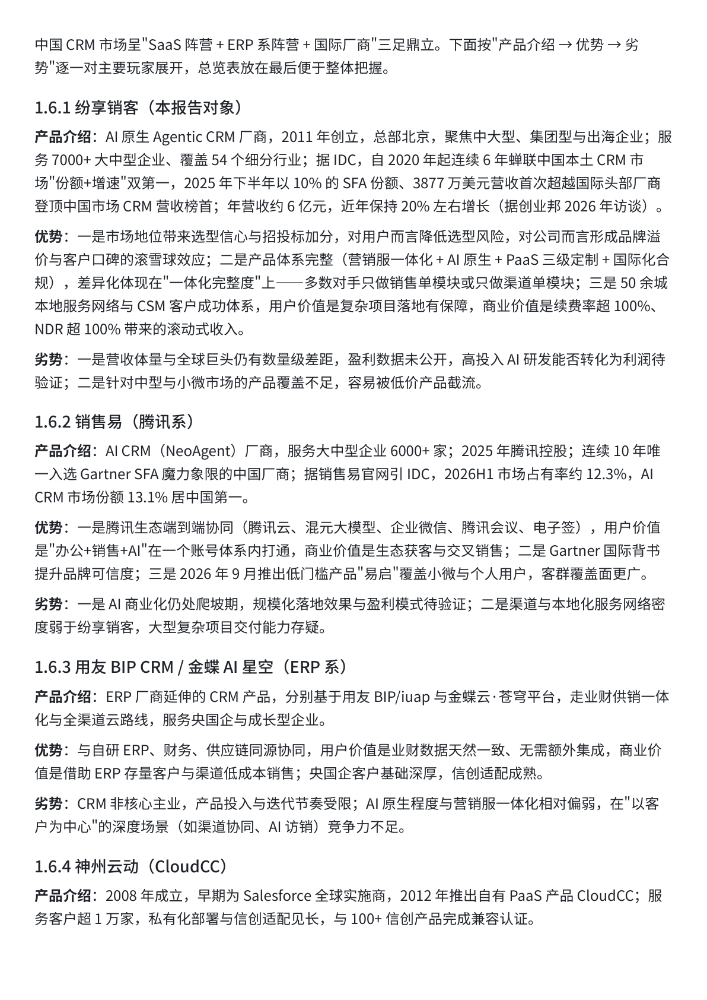
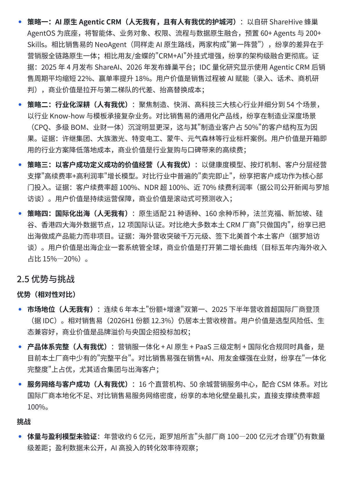

# doubao-competitor-report

> 竞品分析报告生成 Skill：输入「公司/产品名称 + 赛道」，自动产出**面向专业评审与面试官**的中文竞品分析报告，并交付为可协作的飞书在线文档。

本项目是一个 Claude Skills 格式的技能包，兼容 **豆包工作台（Doubao Work）** 及其他支持 Skills 机制的 Agent 环境。它把"产品经理竞品分析"的方法论固化成可复用的执行流程：五段式结构、高干货比、证据导向、差异化对比、机会导向总结。

---

## ✨ 特性

- **一句话触发**：只需输入产品名称（+ 赛道/行业），自动完成调研 → 写作 → 排版 → 交付飞书文档全流程
- **五段式专业结构**：行业分析 → 定位 → 能力与资源 → 场景与体验 → 总结
- **面试官导向**：面向专业评审而非大众读者，压缩泛化背景（行业分析约全文 20%），提高干货比
- **数字编号 + 文档目录**：1. / 1.1 / 1.1.1 式编号，四级标题可直达，方便面试官快速浏览与追问
- **痛点 → 方案一一对应**：每条痛点配概括小标题，SaaS 解决方案逐条回应，体现结构化思维
- **竞争态势铺开阐述**：每个玩家按"产品介绍 → 优势 → 劣势"详细展开（如 1.6.1–1.6.4），总览表置于文后
- **证据底线**：所有数据标注来源（IDC、Gartner、招股书、财报、公开访谈等）；体验内容注明"基于公开资料"，**不编造**访谈、案例与数据
- **机会导向总结**：不止评价竞品，还给出"借鉴什么、避免什么、如何竞争"的落地建议
- **深度可调**：默认精简版 8000–12000 字，可指定完整版 15000–30000 字

## 📸 使用效果

以下为真实生成的《纷享销客竞品分析报告》（V2）截图，演示本 Skill 的产出样式：

**1. 报告开头**——副标题、阅读说明与证据声明、数字编号的行业分析章节：



**2. 竞争态势**——按 1.6.1–1.6.4 逐厂商"产品介绍 → 优势 → 劣势"铺开阐述：



**3. 核心竞争策略**——策略带竞品对比与证据（IDC 数据、客户案例），每条写明用户价值与商业价值：



> 完整报告可在线查看：https://qihnrj26oni.feishu.cn/docx/AbxfdHJxWooOomxbMmEcwzhNnvc

---

## 🚀 快速开始

### 1. 安装

**方式 A（推荐）：豆包工作对话内一句话安装**

在豆包工作中粘贴以下两行发送，AI 会自动克隆并安装：

```
帮我安装一下这个 skill
https://github.com/153496792-sudo/doubao-competitor-report.git
```

**方式 B：手动放置文件夹**

把 `doubao-competitor-report` 整个文件夹放入你的 Skill 根目录：

| 环境 | 安装位置 |
|---|---|
| 豆包工作台（Doubao Work） | `.../workspace/.user_skills/doubao-competitor-report`（或 `.skills/`） |
| 其他支持 Claude Skills 的 Agent | `~/.agents/skills/doubao-competitor-report` 或对应的 skills 目录 |

> 也可直接下载本仓库的 ZIP（Code → Download ZIP），解压后移动 `doubao-competitor-report` 文件夹即可。

### 2. 触发

对 AI 说一句话即可，例如：

```
分析纷享销客，CRM 赛道
用竞品报告技能，拆解有赞，私域电商赛道
帮我写一份某产品的竞品分析报告（完整版）
```

- 必填：竞品公司/产品名称
- 可选：赛道/行业（如 CRM、电商SaaS ERP、进销存SaaS；缺失时按产品名推断）
- 可选：深度档位（默认精简版，可指定完整版）

### 3. 交付物

自动生成飞书在线文档（豆包工作台内即豆包文档），可直接分享、评论与协作。

---

## 📋 报告结构

| 章节 | 内容要点 |
|---|---|
| **一、行业分析**（约全文 20%） | 市场规模先给量化结论、客户群体分层、痛点（带小标题）、SaaS 方案（与痛点一一对应）、付费意愿分层、竞争态势 |
| **二、定位** | 目标客群、核心产品模块逐个简述、定位演变（"事件列 + 定位列"两列表格 + 分阶段总结）、核心竞争策略（稀缺差异化 + 竞品对比 + 证据）、优势/挑战（写明用户价值与商业价值）、不足与建议（含利弊权衡与同行案例） |
| **三、能力与资源** | 能力 3 项、资源 3 项，尽量量化并突出稀缺性，配案例与价值说明 |
| **四、场景与体验** | 2 个代表性业务场景，按"痛点 → 方案 → 功能要点 → 差异化优势 → 客户案例 → 建议"展开；体验注明"基于公开资料" |
| **五、总结** | 机会导向：借鉴经验、避免的错误、对竞品的建议、作为竞争对手的打法、与自身经验的结合 |

## 🧰 深度档位

| 档位 | 痛点 | 战略 | 优势/挑战 | 场景数 | 字数 |
|---|---|---|---|---|---|
| 精简版（默认） | 2-4 条 | 2-3 条 | 优势 3 / 挑战 2 | 2 | 8000–12000 |
| 完整版 | 4-6 条 | 2-5 条 | 优势 3-5 / 挑战 2-4 | 2-4 | 15000–30000 |

## 🔍 调研与证据规范

- 只基于**公开渠道**调研（官网、官方文档、公开评测、媒体报道、招股书/财报、IDC/Gartner/艾瑞等第三方报告），不注册试用
- 每条关键数据标注来源；来源不明的内容写"据公开资料估计"或省略
- 体验类内容一律注明"基于公开资料"；不编造截图、客户案例、访谈记录与数据
- 官网宣传数据尽量交叉验证（创始人访谈、第三方报告、行业分析）后再采用

## ❓ FAQ

**Q1：安装后不触发怎么办？**
确认 Skill 文件夹放在了正确的根目录（见上方安装表），且提问包含产品名称与"竞品分析 / 竞品报告 / 拆解 / 对标分析"等意图词。

**Q2：一定要在豆包工作台才能用吗？**
报告生成逻辑与结构规范完全通用；文档交付依赖运行环境的飞书文档能力。在其他 Agent 环境可配合各自平台的文档与搜索工具使用。

**Q3：报告里的数据可靠吗？**
本 Skill 强制"证据底线"：数据必须来自可追溯的公开来源并标注，体验内容注明基于公开资料，不编造访谈、案例与数据。官网宣传数据会尝试交叉验证。

**Q4：为什么报告开头不重复文档标题？**
文档标题已由飞书标题栏展示，正文首行重复属于冗余；Skill 已内置回读校验，确保正文直接以副标题/导语开始。

**Q5：支持分析哪些产品/赛道？**
通用型 Skill，不限行业。已验证场景：CRM（纷享销客）、ERP SaaS、零售商城、进销存 SaaS 等；输入产品名称即可，赛道可自动推断。

**Q6：生成到哪里？怎么给别人看？**
交付为飞书/豆包在线文档，可直接分享链接、添加协作者、评论留言。

**Q7：能不能生成 Word / PDF？**
当前默认交付飞书在线文档；文档支持导出为 Word / PDF（在线文档的导出功能即可完成）。

**Q8：如何更新到最新版本？**
`git pull`（克隆安装）或重新下载仓库 ZIP 覆盖旧文件夹即可。

**Q9：Skill 文件夹里有 `#` 符号会被转换吗？**
不会。Skill 明确要求报告正文保留 `#` 原样，不做标题转换处理。

**Q10：报告里为什么特意区分"基于公开资料"？**
因为真实的一手信息（用户访谈、亲身体验）不是每次都能获得。Skill 要求：没有就明确标注，绝不编造，保证报告经得起专业面试官追问。

## 📌 版本记录

- **v2.1（当前）**：修复"正文首行重复文档标题"问题，新增回读校验规则
- **v2.0**：按产品经理面试点评升级——数字编号、痛点小标题、方案与痛点一一对应、竞争态势铺开阐述、证据底线、总结机会导向
- **v1.0**：初版，五段式结构与精简版档位

## 🧩 目录结构

```
doubao-competitor-report/
├── SKILL.md                          # 技能入口：触发方式、执行流程、证据底线
└── references/
    ├── report-structure.md           # 五段报告结构及各节内容要求
    └── format-guide.md               # 数字编号、证据规范与行文要求
```

## 📄 许可

本项目以 Skill 形式开源分享，欢迎自由下载、安装与二次开发。请保留原出处信息。

---

*如果你觉得这个 Skill 有用，欢迎 Star ⭐ 或在 Issues 里提出改进建议。*
